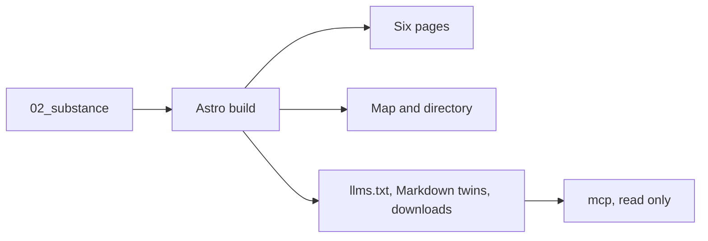

# Site spec · fusioncanyon.co

*Approved by the owner, 2026-11-16. Steps: [`tasks.md`](tasks.md). Scores: the [Quality page](https://colorado-startups.github.io/fusion-canyon/).*

## Decided

| Topic | Decision |
|---|---|
| Cities | Fort Collins, Loveland, Windsor. Greeley is out |
| Tagline | Build for fusion. |
| Look | Light only. The two-walls mark. Teal, copper and canyon red |
| Fantasy | A plasma phoenix from the crest's ring of fire. The Poudre Gate at the canyon mouth |
| Directory | In the corridor, and on a supply chain link or in energy |
| Map line | Main roads. The west edge moves toward the Foothills Campus |

## Pages

| Route | Job | Main action |
|---|---|---|
| `/` | Show the corridor in one scroll | Fly the Poudre |
| `/map/` | Find any site | Explore the live map |
| `/directory/` | List who is here | Add your organisation |
| `/fusion/` | Explain laser fusion and its gaps | Fire one shot |
| `/sources/` | Prove every figure | Download the data |
| `/about/` | Say who is behind it | Join the region |

## Data, in `02_substance/`

| File | Holds |
|---|---|
| `facts.yaml` | One figure per row: value, kind, source, link, date read |
| `sites.geojson` | Each organisation: link, kind, town, status, source |
| `timeline.yaml` | Dated events with a fixed status verb |
| `region.yaml` | Name, cities, loop roads, the four questions |

A page prints a number only through a fact id.

## Stack

| Part | Choice |
|---|---|
| Framework | Astro, static, in `site/` |
| Hosting | Cloudflare Workers static assets, Free plan |
| Worker | Two routes: `/mcp` and `/media/*` |
| Map | MapLibre GL JS, loaded on a press |
| Checks | Git Crafter and the Lighthouse CLI |

## Targets

| Score | Target |
|---|---|
| Quality page | Every tab at its goal |
| Lighthouse, mobile | Top score in four categories, every agent audit passing |
| AI answers | All four, each with a source link, from two agents given only the URL |

The four questions

1. Which laser facilities operate in the corridor today, and how powerful are they?
2. What opens next, and when?
3. Does any laser fusion machine put power on a grid today?
4. How do Fusion Canyon and Photon Mountain fit together?

