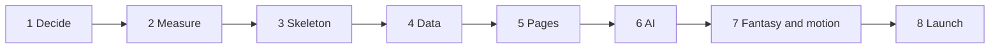

# Tasks

*Source of truth for the Fusion Canyon work queue. Cards live on the [project board](https://github.com/orgs/Colorado-Startups/projects/8). One Active task at a time as a norm.*

## Active

**FC-2 · Build fusioncanyon.co.** Spec: [`site_spec.md`](site_spec.md).

| # | Milestone | Done when |
|---|---|---|
| 1 | Decide | A search finds Greeley only in the decision note |
| 2 | Measure | The Quality page builds on the latest Git Crafter, with a value or a reason for every metric |
| 3 | Skeleton | `fusioncanyon.co` answers with its security headers |
| 4 | Data | A fact with no source fails the build. Every roster row is complete |
| 5 | Pages | Home, map and fusion each pass Lighthouse |
| 6 | AI | Two agents given only the URL answer the four questions with source links |
| 7 | Fantasy and motion | A loop plays on iPhone. Stills show under reduced motion |
| 8 | Launch | Every Quality page score is at its goal, or a row says why |

| Rule | Detail |
|---|---|
| Pull request | Small, with a table and a linked issue |
| Issue | Opened when its step starts, closed by its pull request |

## Blocked

None.

## Backlog

1. **Fix clip playback on iPhone on the main site.** It waits for milestone 7, which proves the byte-range route here first.

## Done

Details live in each pull request.

| Date | Task |
|---|---|
| 2026-11-16 | Brand decided: the tagline "Build for fusion.", the palette, the phoenix and the Poudre Gate |
| 2026-11-15 | Corridor boundary traced along four roads (#13) |
| 2026-11-12 | Corridor map rebuilt in the repo (#11) |
| 2026-11-12 | FC-1: public and open to contributors (#10) |
| 2026-11-12 | Fact gate and Git Crafter setup (#4) |
| 2026-11-12 | Vision page restored from its Artifact |
| 2026-11-04 | Source record restored |
