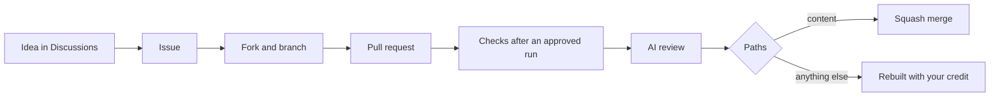

# Contributing

Thank you for helping. Every contribution takes the same path, and AI agents run most of it.



## 1. Start

| You have | Do |
|---|---|
| An idea | Open a [Discussion in Ideas](https://github.com/Colorado-Startups/fusion-canyon/discussions/categories/ideas) |
| A wrong fact or a broken page | Open an issue with the bug form |
| A security problem | [`SECURITY.md`](SECURITY.md); never a public issue |
| Time now | Pick a [`good first issue`](https://github.com/Colorado-Startups/fusion-canyon/labels/good%20first%20issue) |

## What helps most

| Work | Where |
|---|---|
| Source a figure, or correct one, with a primary link | `02_substance/` and `03_deliverables/fusion_canyon_vision.html` |
| Add a corridor site: a lab, a company, a shop | `03_deliverables/map/fusion_canyon_corridor.geojson`, one feature with a `source_url`. Take the coordinate from the US Census Geocoder, USGS or the owner, never OpenStreetMap |
| Weigh in on the name, the tagline "Build with fusion." and the mark | Discussions, Ideas |

## 2. Check it

```bash
git clone https://github.com/<you>/fusion-canyon
cd fusion-canyon
python3 -I tools/voice_lint.py $(git ls-files '*.md')
```

## 3. Change it

| Rule | Why |
|---|---|
| One change per pull request | Small PRs review fast |
| Every figure names its source in the same sentence or row | The page states only what a source says |
| No em dashes | The voice lint blocks them; CI runs the same check |
| Sign off each commit: `git commit -s` | The DCO check requires it |
| No secrets, personal data or contact data | The repo is public |
| Say so when an AI tool wrote part of the change | Reviewers read it with that in mind |

Everything here is [CC0 1.0](LICENSE), code `CC0-1.0 OR 0BSD`. By contributing you offer your change on the same terms.

## 4. Review and merge

| Your PR changes | What happens |
|---|---|
| Only content: Markdown, data, or the vision page in `02_substance/` and `03_deliverables/` | An AI agent reviews it and squash-merges it once the checks pass |
| Any other path: `.github/`, `tools/`, `quality/`, `AGENTS.md`, `CLAUDE.md`, these docs | The orchestrator rebuilds it as its own PR with you as `Co-authored-by`, and links it from yours |

Agents never approve a PR. A fork's run waits for approval and gets no secrets.
